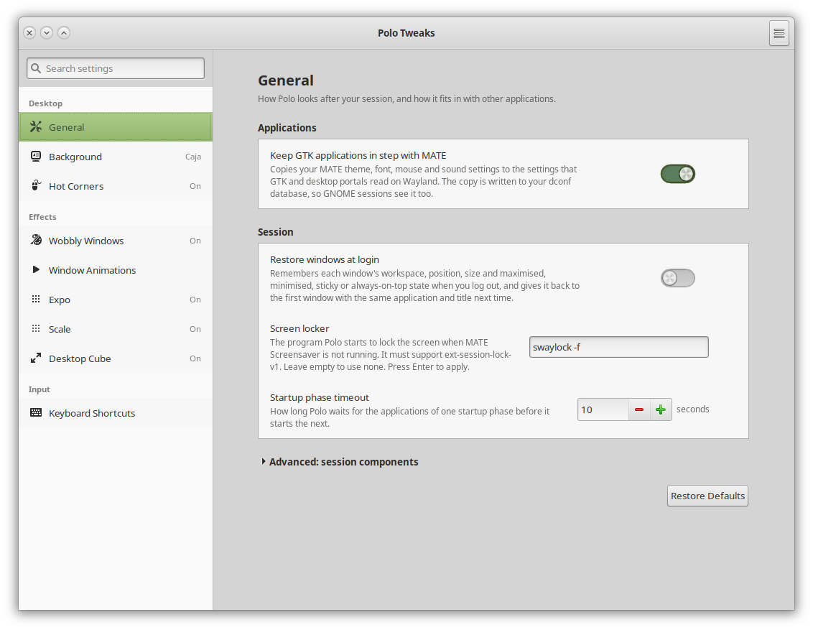

# Polo Tweaks

A settings program for [Polo](https://github.com/keremsoke/polo). It edits every key of Polo's four GSettings schemas:



## Build

Needs Vala, Meson and GTK 3 (`vala meson gtk3-devel` on Fedora). Polo's schemas must be installed.

```sh
meson setup build
ninja -C build
./build/src/polo-tweaks            # or: --page=cube  (general, wobbly, animations, expo, cube, shortcuts)
sudo ninja -C build install        # to install
```
